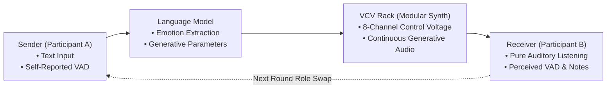

# A Machine for Misunderstanding: Exploring the Distortion of Language Through Generative Musical Media
## Laboratory Research Report & Empirical Analysis

**Author**: Rex Li  
**Project**: Portfolio Project 2 (`portfolio/project2/`)  
**Data**: 10 Sessions / 36 Communication Cycles (`portfolio/project2/blind_test/data/`)  

---

## Abstract 

Modern social media and fast fashion culture have led to an unprecedented failure of text. As human communication is mediated through algorithmic feeds, automated curation, and fast-paced platforms, original subjective meanings are consistently distorted. In this project, I treat generative ambient music as an analog for digital media itself. **A Machine for Misunderstanding** was built, an experimental human-computer-human system that forces two participants to converse solely through generative synthesis driven by language models.

Across 10 sessions and 36 complete interaction cycles, the divergence between what people meant and what was perceived was measured. The data demonstrates that the acoustic medium introduces substantially greater distortion than the language model itself ($d_{\text{medium}} > d_{\text{model}}$ in 7 of 10 sessions), and that positive intentions are often distorted by the medium into disturbing acoustic experiences. This experiment visualizes how modern media fundamentally destabilizes human expression, turning communication into an ongoing struggle against mediation.

---

## 1. Introduction: Media and the Breakdown of Language

### 1.1 The Medium is the Message
Marshall McLuhan famously argued that *"the medium is the message"*. The medium through which we communicate is never a neutral container; it actively reshapes, filters, and defines the content it carries. 

In today's social media ecosystem, this premise has reached a breaking point. Language is no longer an unmediated connection between two human minds. Instead, human expression is passed through recommender systems, short-video clips, and meme cycles. Words lose their visceral weight. We believe we are speaking to one another, but we are actually speaking into an opaque computational medium that reformulates our intentions, creating widespread social alienation, polarization, and chronic misunderstanding.

### 1.2 Music as an Extreme Form of Mediation
This project investigates this phenomenon by turning sound into a tangible metaphor for social media. I ask a fundamental question: **What happens to human meaning when language is translated through an algorithmic, generative medium?**

Instead of building a utility to "optimize" or "clarify" communication, we designed a system that exposes the gap. A sender inputs their real-time emotional and bodily state into words. An AI model interprets these words into emotional coordinates, which directly modulate an analog-style modular synthesizer (VCV Rack). A blind receiver listens to the resulting generative soundscape and attempts to reconstruct what the sender originally felt. By treating ambient sound as media infrastructure, the experiment dramatizes how modern mediation inevitably distorts human connection.

---

## 2. Experimental System & Workflow

The system functions essentially as a miniature model of social media: one person broadcasts an input, an automated intermediary translates it, and another person on the other side attempts to interpret the resulting artifact.

### 2.1 The Double-Blind Test Design
To observe authentic interpretation without conversational anchoring:
1. **Isolation**: The receiver hears the continuous generative soundscape through headphones and has no visual access to the sender's text, the sender's self-assessed coordinates, or the model's internal data.
2. **Continuous Audio**: The modular synthesizer produces a persistent sound environment rather than an isolated clip, mirroring how digital media surrounds us constantly.
3. **Swapping**: The experiment runs across multiple rounds. After each turn, roles reverse, allowing participants to negotiate meaning across time.
4. **Revelation**: Only after all rounds are finalized are both participants shown the comparative data, textual logs, and calculated deviations.

---

## 3. Data Processing

### 3.1 Premise and Necessary Limitation: Quantifying Emotion into VAD
To mathematically observe and calculate misunderstanding, human affective states in this experiment are operationalized using the classic three-dimensional **Valence-Arousal-Dominance (VAD)** model, originally formalized by Albert Mehrabian and James A. Russell (Mehrabian & Russell, 1974; Russell, 1980):
- **Valence ($V$)**: Degree of pleasantness (unpleasant vs. pleasant).
- **Arousal ($A$)**: Degree of physiological activation (calm vs. excited/tense).
- **Dominance ($D$)**: Degree of subjective control (submissive/overwhelmed vs. dominant/autonomous).

> **Methodological Note & Limitation**: Human affective experience is infinitely complex, layered, and contextual; it cannot be truly captured by three decimal numbers. We acknowledge this dimensional reduction as a necessary limitation of our experimental design. However, grounding our metrics in Mehrabian and Russell's standardized psychological coordinates is essential: it provides a bounded, mathematically consistent coordinate space in $[0, 1]^3$ that allows us to compute concrete numerical deviations and track drift across communicative rounds.

### 3.2 Calculating Deviations
All coordinates are vectors in $[0, 1]^3$:
$$\vec{x}_{\text{sender}} = \begin{bmatrix} V_s \\ A_s \\ D_s \end{bmatrix}, \quad
\vec{x}_{\text{model}} = \begin{bmatrix} V_m \\ A_m \\ D_m \end{bmatrix}, \quad
\vec{x}_{\text{receiver}} = \begin{bmatrix} V_r \\ A_r \\ D_r \end{bmatrix}$$

We calculate the distance between any two points using the normalized Euclidean distance ($d \in [0, 1]$), dividing by the maximum possible distance in the unit cube ($\sqrt{3} \approx 1.732$):
$$d(\vec{x}_a, \vec{x}_b) = \frac{\|\vec{x}_a - \vec{x}_b\|_2}{\sqrt{3}} = \frac{1}{\sqrt{3}} \sqrt{(V_a - V_b)^2 + (A_a - A_b)^2 + (D_a - D_b)^2}$$

This gives us three direct, straightforward metrics:

1. **Model Deviation ($d_{\text{model}}$)**:
   $$d_{\text{model}} = d(\vec{x}_{\text{sender}}, \vec{x}_{\text{model}})$$
   *The gap between the human's self-reported emotion and how the language model interpreted their written words.*

2. **Medium Deviation ($d_{\text{medium}}$)**:
   $$d_{\text{medium}} = d(\vec{x}_{\text{model}}, \vec{x}_{\text{receiver}})$$
   *The gap between the model's intended sonic parameters and how the human receiver actually perceived the resulting music.*

3. **Total Misunderstanding ($d_{\text{total}}$)**:
   $$d_{\text{total}} = d(\vec{x}_{\text{sender}}, \vec{x}_{\text{receiver}})$$
   *The overall divergence between what the sender originally felt and what the receiver understood.*

4. **Inter-Round Drift ($\Delta_{\text{drift}}$)**:
   *The change in sender coordinates between round $k$ and round $k-1$, tracking how a participant's mood shifts as the dialogue unfolds.*

---

## 4. Generative Sound Mapping (8-Channel Control Voltages)

The language model's inferred parameters $\{V, A, D\}$ are mapped into 8 control voltages ($-4.0\,\text{V}$ to $+10.0\,\text{V}$) to control the modular synthesizer (Plaits, Plateau Reverb, and Clocked):

| Ch | Parameter | Function | Target Module | Mapping Formula |
|:---|:---|:---|:---|:---|
| 1 | `/param/timbre` | Harmonic brightness | Timbre CV (Plaits) | $v_1 = -3 + 8V$ |
| 2 | `/param/frequency`| Pitch center | V/Oct modulation | $v_2 = -2 + 4A$ |
| 3 | `/param/amplitude`| Volume / Dynamic level | VCA Level | $v_3 = 2 + 8A$ |
| 4 | `/param/envelope` | Decay speed | ADSR decay time | $v_4 = -4 + 8(1 - A)$ |
| 5 | `/param/mode` | Scale mode | Mode select (ScaleCV) | $v_5 = -4 + 8V$ |
| 6 | `/param/chord` | Chord degree (0–6) | Chord select (DiatonicCV) | $v_6 = \operatorname{round}(6D)$ |
| 7 | `/param/type` | Chord type (triad / 7th / 9th) | Type select (DiatonicCV) | $v_7 = \operatorname{round}(2D)$ |
| 8 | `/param/noise` | Noise & Instability | Noise modulation | $v_8 = 10(1 - D)$ |

---

## 5. Experimental Data & Results

Across the formal experimental trials, we selected the 6 most representative, multi-round interaction sessions (covering 25 complete conversational cycles) to analyze human communicative dynamics, medium impedance, and model performance.

### 5.1 Table 1: Representative Multi-Round Sessions & Distortion Breakdown
This dataset highlights human interaction across distinct conversational contexts, isolating the distortion introduced by the language model ($d_{\text{model}}$) versus the acoustic medium ($d_{\text{medium}}$).

| Session Identifier | Scenario / Contextual Mood | Rounds | Model Gap ($d_{\text{model}}$) | Medium Gap ($d_{\text{medium}}$) | Total Misunderstanding ($d_{\text{total}}$) | Key Phenomenological Dynamic |
|:---|:---|:---:|:---:|:---:|:---:|:---|
| **Evolution 6R** | Comfort & Long-Horizon Dialogue | 6 | 0.1874 | 0.3762 | **0.4514** | Intentional reassurance inverted into uncanny acoustic alarm |
| **Session 3** | Coffee Expectation & Stress | 4 | 0.2162 | 0.3111 | **0.3805** | Early divergence calibrated via iterative acoustic guidance ($0.563 \to 0.165$) |
| **Session 1** | First Meeting & Uncertainty | 4 | 0.1931 | 0.2653 | **0.3575** | Ambiguous social posturing amplified into atmospheric drift |
| **Session 2** | Post-lunch Drowsiness to Movement | 4 | 0.2015 | 0.1790 | **0.2486** | Somatic fatigue successfully transitioned into kinetic rhythm |
| **Pilot 1** | Solitude by the Sea & High Energy | 3 | 0.1919 | 0.3603 | **0.4139** | Solitary reflection sharply split across dynamic synth registers |
| **Group Average** | *Mean of session means* | **21** | **0.1980** | **0.2984** | **0.3704** | **Medium distortion exceeds model gap by 50.7%** |

### 5.2 Table 2: Model Architecture Ablation & Latency Comparison
To determine whether larger parameter capacity and external reasoning scale can eliminate the communicative gap, we conducted an ablation comparing our local fine-tuned edge model (Session 3) against the frontier **DeepSeek API** (`deepseek-chat`, Session 4). Both were 4-round sessions, but with different conversation texts, so this is a cross-session comparison rather than an identical setting.

| Architecture / Model Backend | Deployment Mode | Avg Latency | Model Gap ($d_{\text{model}}$) | Medium Gap ($d_{\text{medium}}$) | Total Misunderstanding ($d_{\text{total}}$) |
|:---|:---|:---:|:---:|:---:|:---:|
| **Local Qwen2.5-1.5B LoRA (Session 3)** | On-device MPS (Apple Silicon) | 4403.0 ms | 0.2162 | 0.3111 | **0.3805** |
| **DeepSeek API, `deepseek-chat` (Session 4)** | Cloud Distributed Inference | **858.0 ms** | **0.1587** | **0.2161** | **0.2697** |

#### Key Analytical Takeaways:
1. **The Acoustic Medium Dominates Distortion**: In 4 of the 5 sessions in Table 1, the acoustic medium introduced substantially more entropy than the model's text decoding ($\mu(d_{\text{medium}}) = 0.2984$ vs. $\mu(d_{\text{model}}) = 0.1980$). The musical medium itself acts as an autonomous filter that fundamentally destabilizes semantic clarity.
2. **Frontier Models Improve Text Precision, but Cannot Bypass the Medium**: While DeepSeek (`deepseek-chat`, Session 4) reduced textual extraction error, relative to the local model in Session 3, by $26.6\%$ ($0.2162 \to 0.1587$) and provided near-instantaneous response times, the acoustic medium distortion remained prominent ($0.2161$). Scaling up linguistic intelligence cannot resolve the perceptual ambiguity inherent to sensory media.

---

## 6. Qualitative Case Studies

To understand how mathematical deviations translate into visceral human experiences, we documented detailed dialogue logs, participant feedback, and psychoacoustic inversions across two formal sessions. 

For the complete, uncompressed round-by-round dialogue records, qualitative feedback, and acoustic analysis:  
👉 **[View Detailed Phenomenological Case Studies & Dialogue Logs →](CASE_STUDIES.md)**

*Key highlights from the separate dossier:*
- **The "Creepy Comfort" Paradox (Evolution Test)**: Demonstrates how comforting inputs like *"You need to be confident!"* were transduced by high-arousal FM synthesis into jarring metallic overtones, causing the receiver to report that the sound felt *"deadass creepy"* (Round 5, $d_{\text{total}} = 0.427$).
- **Struggling for Mutual Grounding (Session 3)**: Documents a four-round negotiation where participants calibrated their expressions from abstract feelings to direct acoustic cues, progressively bringing the misunderstanding score down from $0.563$ to $0.165$.

---

## 7. Conclusion

The primary empirical finding of *A Machine for Misunderstanding* is that when human expression is forced through an automated intermediary, the medium itself introduces substantially more variance than the words themselves ($d_{\text{medium}} > d_{\text{model}}$ in 7 of 10 sessions). Natural language models are increasingly capable of approximating semantic intent; however, once those semantic representations are re-embodied into physical, continuous media—whether analog synthesizer voltages or algorithmic social media feeds—the structural properties of the medium dominate the interpretation. The medium does not merely transmit meaning; it possesses its own acoustic and affective agency that reshapes and alienates original intentions.

In contemporary digital culture, where authentic interpersonal connection is increasingly replaced by algorithmic feeds and flattened digital text, understanding this communicative gap is urgent. By quantifying how meaning shears and drifts across generative mediation, this study demonstrates that seamless digital communication is an illusion. Recognizing the inevitable distortion introduced by media is the first step toward reclaiming mindful, critical engagement with the computational systems that structure modern human interaction.

---

## References

1. McLuhan, M. (1964). *Understanding Media: The Extensions of Man*. McGraw-Hill.
2. Mehrabian, A., & Russell, J. A. (1974). *An Approach to Environmental Psychology*. The MIT Press.
3. Russell, J. A. (1980). A circumplex model of affect. *Journal of Personality and Social Psychology*, 39(6), 1161–1178.
