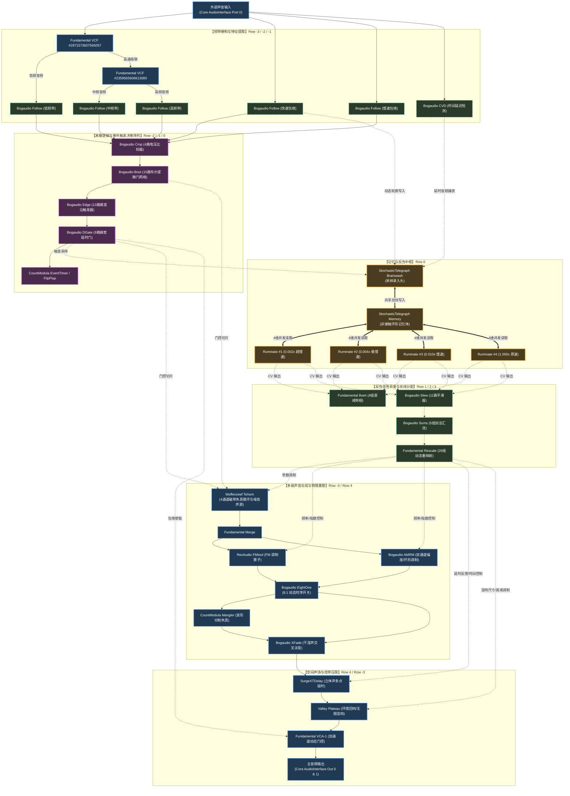

# Project 3 VCV Rack 深度拓扑反编译与系统分析报告

> **工程文件**：`portfolio/project 3/Project_3-V0.1.2.vcv`  
> **分析工具**：`.agent/skills/vcv-patch-analyzer`  
> **模块总量**：134 个模块 | **连接缆线**：226 根跳线 | **色标规范**：8 色功能线缆  
> **哲学/立意映射**：深度呼应 `Project 3.md` 中 *「Sampling is a process of listening / 采样是倾听的过程 / 系统自指反刍与声学反馈回路」* 的核心理念。

---

## 一、 系统全景与设计哲学 (System Overview)

本工程构建了一套**基于声学事件自驱动、多尺度时间膨胀（Multi-timescale Temporal Dilation）与非线性重组的声音「反刍（Rumination）」系统**。

与传统的固定节拍（Clock-based）模块化工程不同，该 Patch **完全没有使用任何常规的固定 BPM 外部主时钟模块**，其系统动力学全部源于：
1. **外部倾听（Ingress Listening）**：来自现场麦克风的真实世界声音输入。
2. **频带分离与决策逻辑（Acoustic Feature Extraction & Discrete Logic）**：双极滤波与多路包络检测，将连续音频瞬态量化为神经元式的离散脉冲。
3. **记忆体与反刍网络（Memory Ensemble & Rumination）**：利用 `StochasticTelegraph` 的共享内存总线，由 `Brainwash` 实时录制现场片段，并由 4 个独立的 `Ruminate` 反刍读取头以不同速率（1.0x 实时、0.010x、0.004x、0.002x 超慢速膨胀）异步回放。
4. **声学生成与重塑变换链（Sound Generation & Transformation Chain）**：Tehom 磁带杂音循环器、RexAudio FMtool 调频合成、双路 AM/RM 调制、8:1 状态多路复用切换器、CountModula Mangler 塑形失真，以及 Surge XT Delay + Valley Plateau 广袤声场。
5. **系统闭环（Acoustic / Information Feedback）**：生成的复杂声景通过扬声器释放回现场物理空间，与物理声学环境及外部输入再度交融，达成「系统自我聆听与演化」。



---

## 二、 全局架构速览 (Global Infrastructure)

### 1. 主时钟与触发机制 (Event-Driven Timing Mechanics)
- **无传统 LFO/Clock**：工程完全抛弃了固定的主时钟，是一套**纯声学事件驱动系统（Acoustically Reactive Engine）**。
- **频带触发器（3-Band Spectral Triggers）**：
  - 由 `Fundamental VCF #2871573607565057` 与 `VCF #2359565606613080` 构成级联交叉分频器（Crossover Filterbank）。
  - 分离出的高频、中频、低频信号分别送入 3 个 `Bogaudio Follow` 包络跟随器。
  - 每个频带接入 `Bogaudio Cmp` 比较阈值，配合 `Bogaudio Edge` 抓取瞬态跃变上升沿，并由 `Bogaudio DGate` 塑形为精密的 Gate 脉冲。
- **时间节律发生器**：
  - `CountModula EventTimer (#5401982438469252)` 监听全频与高频的逻辑组合输出，测量声学事件之间的时间间隔，作为系统的相对时间尺度，并在达到时间条件时通过 `Bogaudio FlipFlop (#8228673527234285)` 翻转系统工作状态。

### 2. 混音总线与核心声部划分 (Bus & Voice Architecture)
系统主要包含两大核心发声/变换支路：
- **声部 A：Tehom 模拟噪波与失真磁带循环（Lo-fi Sound-on-Sound Looper）**
  - 由 `Moffenzeef Tehom (#573630903859716)` 负责，它同时接收延迟后的输入音频和内部噪波，输出双声道饱满脏浊的底色。
- **声部 B：反刍调频与环形调制再合成链（FM & Ring Mod Resynthesis Chain）**
  - 由 `RexAudio FMtool (#5448845321718658)` 和 2 组 `Bogaudio AMRM` 组成，通过 8:1 状态复用器 `EightOne (#3957280340259540)` 在不同算法间自动跳转切分。

### 3. Aux 空间与空间回响系统 (Spatial Effects Infrastructure)
- **SurgeXTDelay (#8036297498552388)**：
  - 立体声多点延时算法，延时时间和反馈量不固定，而是受 `StochasticTelegraph Ruminate` 的多轨平滑 CV（通过 `Sums` 与 `Rescale`）实时调制。
- **Valley Plateau (#3124939407402176)**：
  - 高级扩散板式混响。
  - Size / Decay / Filter 受 `Bogaudio Slew (#8838472082447097)`（源自超慢速反刍头 0.002x）直接控制，赋予整个系统浩瀚、随时间漫长呼吸的物理空灵感。

### 4. 母带输出链 (Master Processing Chain)
- Reverb 双通道输出送入末级双通道独立 VCA：`Fundamental VCA-1 (#5236824020747425)` 与 `VCA-1 (#1936771139572061)`。
- 由 `Bogaudio DADSRH (#2679850334296932)` 生成的总动态包络经 `Bogaudio Slew (#986665339620977)` 滤波后控制总输出音量，彻底消除尖锐突爆音（Anti-click）。
- 最终经由两块 `Fundamental Rescale (#2508585648848661 & #7088927008603767)` 进行电平硬限幅与阻抗匹配，送入 `Core AudioInterface (#412292137363292)` 的 Port 0 (L) 与 Port 1 (R)。

---

## 三、 分声部精确走线与控制清单 (Per-Voice Detailed Wiring)

### 声部 1：声学输入倾听与记忆捕获回路 (Ingress & Memory Buffer Capture)

#### 1. 音频直通与频带拆解走线
- `AudioInterface [Port 0 (In 1)]` $\rightarrow$ `Bogaudio CVD [#8308325478402218] (In 2)` $\rightarrow$ `Rescale [#5031902593800853]` $\rightarrow$ `Brainwash [#8507899597637047] (In 1 - Audio/CV Write Data)`
- `AudioInterface [Port 0 (In 1)]` $\rightarrow$ `Bogaudio Follow [#5174556636425201] (In 2)` $\rightarrow$ `CVD [#5131261656403980]` $\rightarrow$ `Rescale [#6131178096176078]` $\rightarrow$ `Brainwash [#8507899597637047] (In 2 - Envelope Write Data)`
- `AudioInterface [Port 0 (In 1)]` $\rightarrow$ `Fundamental VCF [#2871573607565057] (In 3 - Audio)`
  - `VCF 1 [Port 0 (LPF)]` $\rightarrow$ `Bogaudio Follow [#6258487959677562] (低频能量跟随)`
  - `VCF 1 [Port 1 (HPF)]` $\rightarrow$ `Fundamental VCF [#2359565606613080] (In 3 - 级联二次分频)`
    - `VCF 2 [Port 0 (LPF)]` $\rightarrow$ `Bogaudio Follow [#2050747211726616] (中频能量跟随)`
    - `VCF 2 [Port 1 (HPF)]` $\rightarrow$ `Bogaudio Follow [#6877927634992876] (高频能量跟随)`

#### 2. CV / 门控写入触发
- 低/中/高频包络 $\rightarrow$ `Cmp [963791968795938, 8289274250340423, 5182621650426489]` $\rightarrow$ `Bool 逻辑矩阵` $\rightarrow$ `Edge 跳变检测` $\rightarrow$ `DGate [#1524357811214650] (Port 0)` $\rightarrow$ `Brainwash [Port 0 (Record Trigger)]`
- **执行逻辑**：当外界输入出现特征声学事件（如特定击打、说话声、环境噪声涌入）时，布尔组合逻辑判定命中，向 `Brainwash` 触发采样脉冲，将延迟后的纯净声波与动态包络固化写入 `Memory (#5244717632252103)`。

---

### 声部 2：4 轨多尺度反刍网络 (4-Head Stochastic Rumination)

`StochasticTelegraph Memory (#5244717632252103)` 中的采样数据被 4 组磁头以非线性比例反刍读取：
- **Head 1 (`Ruminate #1285234584578607`)**：
  - 参数：Speed = 0.002（超低速演化，时值扩展 500 倍）
  - 路由：`Port 1` $\rightarrow$ `8vert [#5870937965656068]` $\rightarrow$ `Slew [#1764531092062856]` $\rightarrow$ 输出至混响衰减和多路总线加法器。
- **Head 2 (`Ruminate #8185216893679480`)**：
  - 参数：Speed = 0.004（低速演化，时值扩展 250 倍）
  - 路由：`Port 1` $\rightarrow$ `8vert [#5514636694881408]` $\rightarrow$ `Slew [#8428137590055899]` $\rightarrow$ `Rescale [#4129682272549054]` $\rightarrow$ `Slew [#8838472082447097]` $\rightarrow$ 驱动 `RexAudio FMtool` 的 FM 调制指数与 `Plateau` 的混响空间阻尼。
- **Head 3 (`Ruminate #658318444698984`)**：
  - 参数：Speed = 0.010（中速演化，时值扩展 100 倍）
  - 路由：`Port 1` $\rightarrow$ `8vert [#7835386746155443]` $\rightarrow$ `Slew [#959919402057297]` $\rightarrow$ `Rescale [#5253178029253081]` $\rightarrow$ 驱动 `SurgeXTDelay` 的时钟细分比与反馈率。
- **Head 4 (`Ruminate #7255711873080376`)**：
  - 参数：Speed = 1.000（实时间重现）
  - 路由：`Port 1` $\rightarrow$ `Rescale [#1345174059618605]` $\rightarrow$ 驱动 `RexAudio FMtool` 的载波基频与 `Bogaudio AMRM` 载波瞬时音高。

---

### 声部 3：核心重合成与音色破坏变换链 (Sound Design & Transformation)

#### 1. 音频主信号流
```text
[Moffenzeef Tehom #573630903859716 Out 0 & 1]
    │
    ▼
[Fundamental VCA-1 #8686546352778034 & #4375621078671292 (门控输入)]
    │
    ▼
[Fundamental Merge #8558663324708789 (立体声汇总)]
    │
    ├──> [RexAudio FMtool #5448845321718658 (In 0)] ────> [Bogaudio XFade #6829510399813239]
    │                                                               │
    ├──> [Bogaudio AMRM #8862135323618943 (In 1)] ─────────────────┤
    │                                                               │
    └──> [Bogaudio AMRM #3060107177554200 (In 1)] ─────────────────┤
                                                                    ▼
                                               [Bogaudio EightOne #3957280340259540 (In 0, 1, 2)]
                                                                    │
                                       ┌────────────────────────────┴──────────────────────────┐
                                       ▼                                                       ▼
                    [CountModula Mangler #5392374950274677]                        [Bogaudio XFade #8172487097253200 (In 1)]
                                       │                                                       ▲
                                       └────────────────── (In 2) ─────────────────────────────┘
                                                                                               │
                                                                                               ▼
                                                                           [Fundamental Split #5964556321946803]
                                                                                               │
                                                                                               ▼
                                                                           [SurgeXTRack SurgeXTDelay #8036297498552388]
                                                                                               │
                                                                                               ▼
                                                                           [Valley Plateau Reverb #3124939407402176]
                                                                                               │
                                                                                               ▼
                                                                           [Master VCA-1 Pair #5236824020747425 / #1936771139572061]
                                                                                               │
                                                                                               ▼
                                                                           [Fundamental Rescale #2508585648848661 / #7088927008603767]
                                                                                               │
                                                                                               ▼
                                                                           [Core AudioInterface Out 0 & 1]
```

#### 2. CV 调制源对应表
- **FM 调制基准**：
  - `FMtool In 1 (Freq)` $\leftarrow$ `Rescale [#1345174059618605]`（Head 4 原速动态电压）
  - `FMtool In 2 (Index)` $\leftarrow$ `Slew [#8838472082447097]`（Head 2 平滑电压）
- **AM/RM 调制**：
  - `AMRM 1 In 0 / In 3` $\leftarrow$ `Rescale [#4111037103963252] & [#5678263457369970]`
  - `AMRM 2 In 0 / In 3` $\leftarrow$ `Rescale [#1345174059618605] & [#1695234151580331]`
- **8:1 状态跳步控制**：
  - `EightOne In 10 (Select/Step)` $\leftarrow$ `Bogaudio SampleHold [#1227414405807025]`（捕获事件发生时的瞬间电压作为音色状态跳转开关）
- **波形粉碎控制**：
  - `Mangler In 0 & In 1` $\leftarrow$ `Slew [#4880043465240684] & Slew [#3327049317090764]`（由超慢速 Head 1 与 Head 3 联合揉捏失真曲线）

---

## 四、 核心声部模块角色字典 (Module Role Catalog)

| 模块 ID | 插件与型号 | 机架坐标 (x, y) | 在本 Patch 中的核心任务与角色 |
|---|---|---|---|
| `412292137363292` | **Core AudioInterface** | `[-18, -3]` | 全局音频出入口：Port 0 接收现场环境麦克风输入，Out 0/1 输出最终母带信号 |
| `2871573607565057` | **Fundamental VCF** | `[-8, -3]` | 频带分离级联 1：低频切分与分离，高通输出给级联二级滤波 |
| `2359565606613080` | **Fundamental VCF** | `[-1, -3]` | 频带分离级联 2：从中频和高频进一步分拣出独立频谱分量 |
| `573630903859716` | **Moffenzeef Tehom** | `[6, -3]` | 现场声学底色生成器：4通道 Lo-fi 磁带循环与噪波混合源，接受延迟输入和反刍 CV 调制 |
| `5244717632252103` | **StochasticTelegraph Memory** | `[5, 0]` | 核心记忆中枢：无接触环形共享内存，存储现场声音片段与动态包络 |
| `8507899597637047` | **StochasticTelegraph Brainwash**| `[9, 0]` | 记忆写入头：受声学逻辑事件脉冲触发，将当前现场音频与包络覆写至 Memory |
| `1285234584578607` | **StochasticTelegraph Ruminate** | `[14, 0]` | 反刍读取头 1：0.002x 超慢速回放，提取宏观时间维度的超长声学地貌 |
| `8185216893679480` | **StochasticTelegraph Ruminate** | `[19, 0]` | 反刍读取头 2：0.004x 慢速回放，调制 FM 深度与混响空间阻尼 |
| `658318444698984` | **StochasticTelegraph Ruminate** | `[24, 0]` | 反刍读取头 3：0.010x 中速回放，调制延时反馈率与波形粉碎度 |
| `7255711873080376` | **StochasticTelegraph Ruminate** | `[29, 0]` | 反刍读取头 4：1.000x 原速回放，作为调频基频与环形调制载波直接投射 |
| `5448845321718658` | **RexAudio FMtool** | `[-13, 4]` | 调频算子重塑：将 Tehom 磁带信号作为载波/调制波进行复杂的动态 FM 合成 |
| `8862135323618943` | **Bogaudio AMRM** | `[-5, 4]` | 幅度/环形调制器 A：生成金属感与不谐和分音（Inharmonic sidebands） |
| `3060107177554200` | **Bogaudio AMRM** | `[1, 4]` | 幅度/环形调制器 B：补充次谐波与高频泛音互调分量 |
| `3957280340259540` | **Bogaudio EightOne** | `[7, 4]` | 8通道至1通道开关：由采样保持电压步进切换 FM 与 AMRM 声音切片 |
| `5392374950274677` | **CountModula Mangler** | `[13, 4]` | 模拟波形破坏器：进行非线性多项式折叠、波形粉碎与谐波过载 |
| `8036297498552388` | **SurgeXTRack SurgeXTDelay** | `[29, 4]` | 立体声空间延时：营造复杂的声学空间反射与延迟回声织体 |
| `3124939407402176` | **Valley Plateau** | `[41, 4]` | 扩散混响器：生成漫无边际的声学沉浸尾音与空灵氛围 |
| `5401982438469252` | **CountModula EventTimer** | `[-12, 0]` | 声学间隔时间测量仪：计算外界声音刺激周期，实现宏观状态机翻转 |
| `8228673527234285` | **Bogaudio FlipFlop** | `[-15, 0]` | 双稳态触发器：维持系统的宏观交替状态（如沉静倾听模式 vs 反刍喷发模式） |
| `2428076838400251` | **Bogaudio DADSRH** | `[40, 0]` | 辅助控制包络：产生可调延迟的多段包络控制信号 |
| `2679850334296932` | **Bogaudio DADSRH** | `[53, 4]` | 主输出防爆音总动态包络发生器 |
| `5236824020747425` | **Fundamental VCA-1** | `[66, 4]` | 左声道母带级动态门控放大器 |
| `1936771139572061` | **Fundamental VCA-1** | `[69, 4]` | 右声道母带级动态门控放大器 |

*(注：其余 15 个 `Bool`、13 个 `Edge`、9 个 `DGate`、26 个 `Rescale`、11 个 `Slew` 与 5 个 `Sums` 共同构成了系统的决策神经网络与 CV 标定总线网。)*

---

## 五、 与 Project 3 创作理念的互文对照 (Artistic & Theoretical Grounding)

在 `Project 3.md` 中，Rex 写下了这几句核心陈述：
1. **「Sampling is a process of listening」**  
   $\rightarrow$ 在该工程中，采样不是机械的剪辑，而是通过多频带分频（VCF 1 & 2）与包络提取矩阵（5 个 Follower + 4 个 Cmp + 15 个 Bool），系统像生物耳蜗一样时刻在“倾听”环境声音的能量分布与节律。
2. **「Samplings are controlling themselves」**  
   $\rightarrow$ 录入 `Memory` 的声音在被 `Ruminate` 以 4 种速度吐出后，其输出信号并非仅仅播放，而是**通过 Slew limiters、8vert 和 Rescales 转化为控制电压，反向控制合成器核心（FMtool、AMRM、Mangler、Delay 与 Reverb）**。采样数据自身成为了控制整个 Patch 演化的脑电波。
3. **「Live performance, I listen + 反刍 the msg - finalized outcome, thoughts」**  
   $\rightarrow$ 该 Patch 的物理设计天生为现场表演（Live Performance）而生。麦克风拾取现场的声音作为种子，系统内部进行多重时间膨胀的深层「反刍」，再将重构后的声音释放出来，构建出不可预测却又严密因果自洽的物理反馈回路。

---

## 六、 追问与探索指引 (Interactive Follow-up)

本工程现已完成全拓扑反编译与分析，你可以随时就以下方向提出更细颗粒度的追问：
1. **定向排查**：例如“我想看 `CountModula EventTimer (#5401982438469252)` 的两个输入孔分别是由哪几个逻辑门决定的？”
2. **算法逻辑探秘**：例如“4 个 Ruminate 头输出的电压在送往 Tehom 时，`Sums` 模块是如何混合它们的权重的？”
3. **现场改造建议**：例如“如果我想在 live 现场加入一段 Robin 硬件控制器的传感器手势（如加速度计倾角），应该把它的 CV 插进哪几个 Rescale 模块最能打破现有的平衡？”
